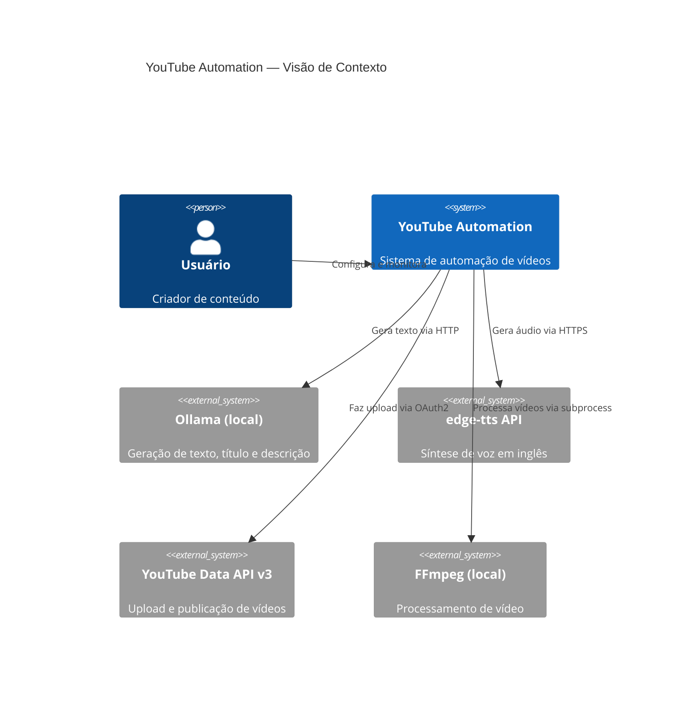
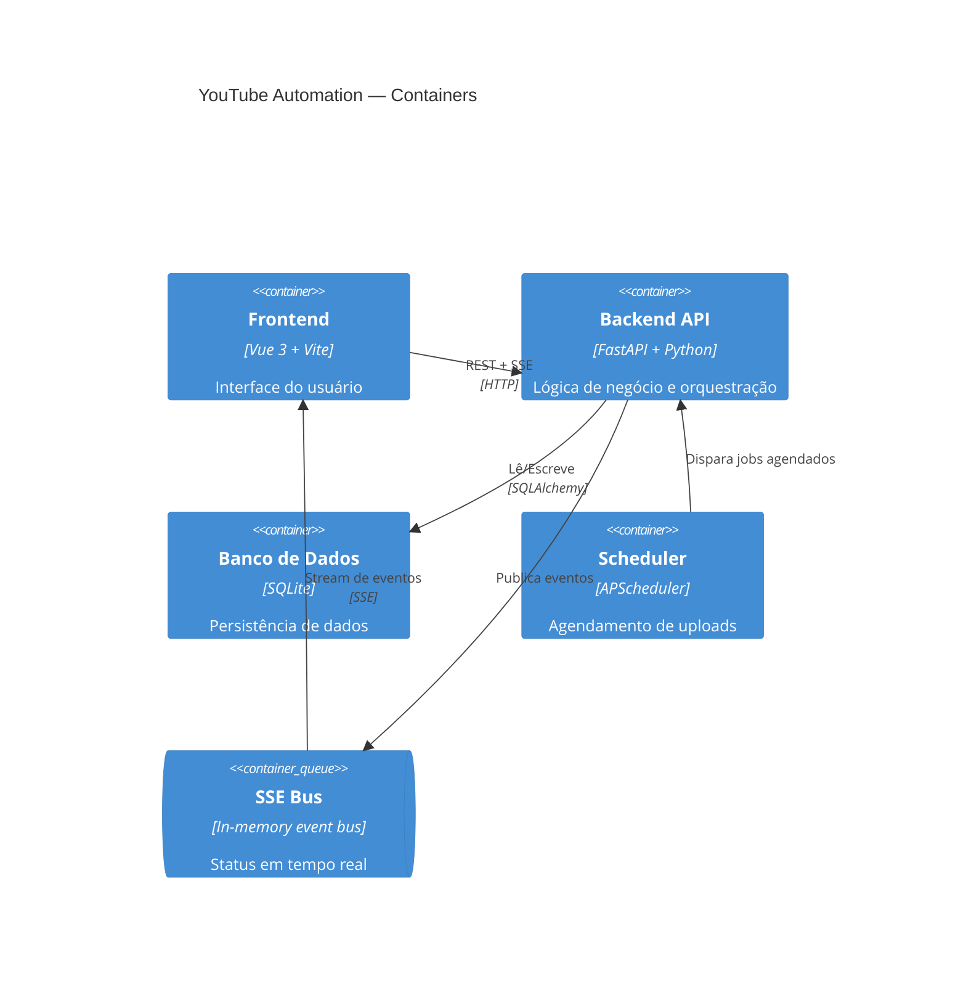
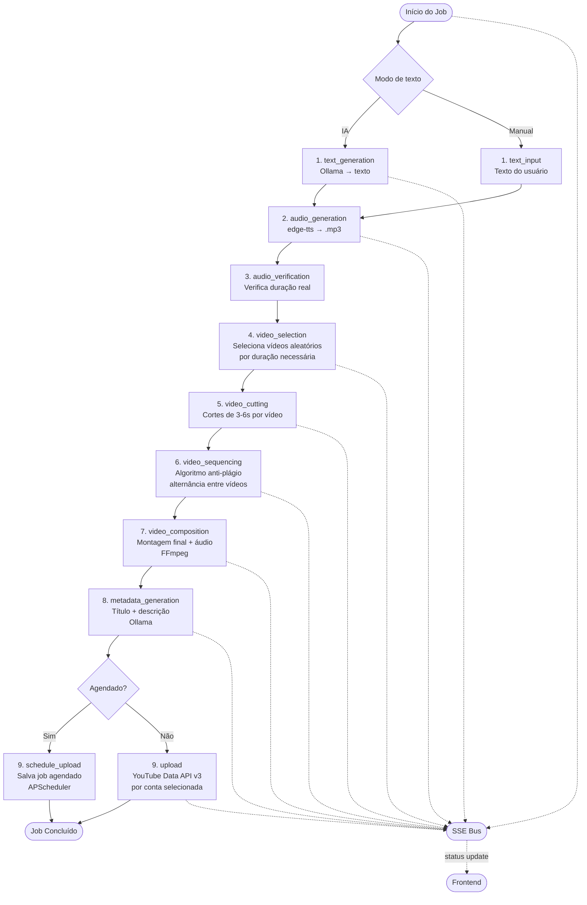

# Especificação Técnica — YouTube Automation

## Decisões de Stack

| Componente | Escolha | Justificativa |
|---|---|---|
| **Backend** | FastAPI (Python 3.11+) | Requisito + async nativo + OpenAPI automático |
| **Banco** | SQLite + SQLAlchemy | Requisito + zero infra + suficiente para o escopo |
| **TTS** | `edge-tts` | Melhor qualidade sem GPU, async nativo, 30+ vozes EN, gratuito |
| **Vídeo** | `ffmpeg-python` | Filtergraphs composáveis, sem risco de injection, erros tipados |
| **Async pipeline** | asyncio + ProcessPoolExecutor + APScheduler | Zero broker externo, compatível com SQLite, simples de manter |
| **Tempo real** | SSE (`sse-starlette`) | Unidirecional = caso de uso exato (servidor → cliente), mais simples que WebSocket |
| **Frontend** | Vue 3 + Vite + Pinia | Requisito |
| **UI Components** | shadcn-vue + Tailwind CSS | Leve, sem lock-in, bundle mínimo, fácil customização |
| **IA local** | Ollama Python client (`ollama`) | Biblioteca oficial, streaming nativo |

---

## ADRs (Architecture Decision Records)

### ADR-001: edge-tts como motor TTS

**Status:** Aceita

**Contexto:** Precisamos gerar áudio em inglês com qualidade, sem GPU, e com suporte a múltiplas vozes. Candidatos: pyttsx3, gTTS, edge-tts, Coqui TTS.

**Decisão:** Usar `edge-tts` (Microsoft Edge TTS via API unofficial).

**Consequências Positivas:**
- Qualidade neural sem GPU local
- API async nativa
- 30+ vozes em inglês
- Gratuito

**Consequências Negativas:**
- Requer conexão de internet (chama API da Microsoft)
- Dependência de serviço externo (pode mudar)

**Riscos:** Se a Microsoft bloquear o acesso, precisaremos migrar para Coqui TTS (local, GPU).

---

### ADR-002: ffmpeg-python para processamento de vídeo

**Status:** Aceita

**Contexto:** Precisamos cortar, concatenar e aplicar áudio em vídeos. Candidatos: moviepy, ffmpeg-python, subprocess direto.

**Decisão:** Usar `ffmpeg-python` com wrapper sobre o binário FFmpeg.

**Consequências Positivas:**
- API fluente e composável
- Sem risco de command injection
- Acesso a todos os filtros do FFmpeg
- Erros tipados

**Consequências Negativas:**
- FFmpeg precisa estar instalado no sistema
- Curva de aprendizado maior que moviepy

**Riscos:** Usuário pode não ter FFmpeg instalado → verificar na inicialização e exibir instrução clara.

---

### ADR-003: SSE para comunicação em tempo real

**Status:** Aceita

**Contexto:** Frontend precisa receber atualizações de status do pipeline em tempo real. Candidatos: WebSocket, SSE, polling.

**Decisão:** Usar SSE via `sse-starlette`.

**Consequências Positivas:**
- Unidirecional = caso de uso exato (servidor → cliente)
- Mais simples que WebSocket
- Suporte nativo nos browsers
- Reconexão automática

**Consequências Negativas:**
- Sem canal bidirecional (mas não é necessário aqui)

---

### ADR-004: asyncio + ProcessPoolExecutor para pipeline

**Status:** Aceita

**Contexto:** O pipeline de vídeo é CPU-bound (ffmpeg) e IO-bound (Ollama, TTS, upload). Precisamos de execução não bloqueante. Candidatos: Celery, RQ, asyncio puro, ProcessPoolExecutor.

**Decisão:** asyncio para tasks IO-bound + ProcessPoolExecutor para tasks CPU-bound + APScheduler para agendamento.

**Consequências Positivas:**
- Zero infraestrutura externa (sem Redis, sem broker)
- Integrado nativamente ao FastAPI
- APScheduler persiste jobs no SQLite

**Consequências Negativas:**
- Não escala horizontalmente (single process)
- Para escala futura, seria necessário migrar para Celery

---

### ADR-005: Arquitetura modular por etapas de pipeline

**Status:** Aceita

**Contexto:** O usuário precisa executar etapas isoladas para debug. Isso exige que cada etapa seja um módulo independente com interface bem definida.

**Decisão:** Cada etapa do pipeline é um serviço Python com interface `execute(input: StepInput) -> StepOutput` e pode ser chamado diretamente pela API.

**Consequências Positivas:**
- Debug por etapa
- Testabilidade unitária de cada etapa
- Substituição futura de qualquer etapa sem afetar as outras
- Expansibilidade (novos provedores de TTS, novos destinos)

**Consequências Negativas:**
- Mais arquivos e interfaces para manter
- Serialização do estado entre etapas

---

### ADR-006: shadcn-vue + Tailwind para UI

**Status:** Aceita

**Contexto:** Precisamos de componentes UI para o frontend Vue 3. Candidatos: Vuetify, PrimeVue, shadcn-vue + Tailwind.

**Decisão:** shadcn-vue + Tailwind CSS.

**Consequências Positivas:**
- Bundle leve (tree-shaking perfeito)
- Sem lock-in de tema
- Componentes acessíveis por padrão (Radix primitives)
- Fácil customização

**Consequências Negativas:**
- Menos componentes out-of-the-box que Vuetify
- Setup inicial mais manual

---

## Estrutura de Diretórios

```
youtube-automation/
├── backend/
│   ├── app/
│   │   ├── api/
│   │   │   ├── __init__.py
│   │   │   ├── routes/
│   │   │   │   ├── accounts.py         # Rotas de contas YouTube
│   │   │   │   ├── jobs.py             # Rotas de processamentos
│   │   │   │   ├── settings.py         # Rotas de configurações
│   │   │   │   ├── ollama.py           # Rotas de integração Ollama
│   │   │   │   └── sse.py              # Endpoint SSE de status
│   │   │   └── deps.py                 # Dependências (DB session, etc.)
│   │   ├── services/
│   │   │   ├── text_generation/
│   │   │   │   ├── __init__.py
│   │   │   │   ├── base.py             # Interface base TextGenerator
│   │   │   │   ├── ollama_generator.py # Implementação Ollama
│   │   │   │   └── schemas.py          # TextGenInput / TextGenOutput
│   │   │   ├── audio/
│   │   │   │   ├── __init__.py
│   │   │   │   ├── base.py             # Interface base AudioGenerator
│   │   │   │   ├── edge_tts.py         # Implementação edge-tts
│   │   │   │   └── schemas.py          # AudioGenInput / AudioGenOutput
│   │   │   ├── video/
│   │   │   │   ├── __init__.py
│   │   │   │   ├── selector.py         # Seleção aleatória de vídeos
│   │   │   │   ├── cutter.py           # Cortes de 3-6s por vídeo
│   │   │   │   ├── sequencer.py        # Algoritmo anti-plágio
│   │   │   │   ├── composer.py         # Montagem final do vídeo
│   │   │   │   └── schemas.py          # VideoInput / VideoOutput
│   │   │   ├── youtube/
│   │   │   │   ├── __init__.py
│   │   │   │   ├── auth.py             # OAuth2 flow
│   │   │   │   ├── uploader.py         # Upload via YouTube Data API
│   │   │   │   └── schemas.py          # UploadInput / UploadOutput
│   │   │   └── metadata/
│   │   │       ├── __init__.py
│   │   │       └── generator.py        # Geração título/descrição via Ollama
│   │   ├── pipeline/
│   │   │   ├── __init__.py
│   │   │   ├── runner.py               # Orquestrador do pipeline completo
│   │   │   ├── steps.py                # Enum e definição das etapas
│   │   │   └── state.py                # Estado compartilhado entre etapas
│   │   ├── models/
│   │   │   ├── __init__.py
│   │   │   ├── account.py              # Model: YouTubeAccount
│   │   │   ├── job.py                  # Model: ProcessingJob
│   │   │   ├── job_step.py             # Model: JobStep
│   │   │   └── settings.py             # Model: SystemSettings
│   │   ├── schemas/
│   │   │   ├── account.py
│   │   │   ├── job.py
│   │   │   └── settings.py
│   │   ├── db/
│   │   │   ├── __init__.py
│   │   │   ├── database.py             # Engine + SessionLocal
│   │   │   └── migrations/             # Alembic migrations
│   │   └── core/
│   │       ├── config.py               # Pydantic Settings
│   │       ├── events.py               # SSE event bus
│   │       └── exceptions.py           # Exceções customizadas
│   ├── tests/
│   │   ├── services/
│   │   └── api/
│   ├── main.py                         # Entrypoint FastAPI
│   ├── requirements.txt
│   └── .env.example
│
├── frontend/
│   ├── src/
│   │   ├── views/
│   │   │   ├── DashboardView.vue       # Tela inicial — status
│   │   │   ├── AccountsView.vue        # Contas conectadas
│   │   │   ├── NewJobView.vue          # Novo processamento
│   │   │   └── SettingsView.vue        # Configurações
│   │   ├── components/
│   │   │   ├── job/
│   │   │   │   ├── JobCard.vue
│   │   │   │   ├── JobStatus.vue
│   │   │   │   ├── StepDebugger.vue    # Execução por etapa
│   │   │   │   └── StepOutput.vue      # Output de cada etapa
│   │   │   ├── accounts/
│   │   │   │   ├── AccountCard.vue
│   │   │   │   └── OAuthButton.vue
│   │   │   └── forms/
│   │   │       ├── TextGenForm.vue
│   │   │       ├── AudioForm.vue
│   │   │       ├── VideoForm.vue
│   │   │       └── UploadForm.vue
│   │   ├── stores/
│   │   │   ├── jobs.ts                 # Pinia: processamentos
│   │   │   ├── accounts.ts             # Pinia: contas YouTube
│   │   │   └── settings.ts             # Pinia: configurações
│   │   ├── services/
│   │   │   ├── api.ts                  # Axios instance
│   │   │   └── sse.ts                  # SSE client
│   │   ├── router/
│   │   │   └── index.ts
│   │   ├── App.vue
│   │   └── main.ts
│   ├── package.json
│   └── vite.config.ts
│
└── docs/
    ├── especificacao-produto.md
    └── especificacao-tecnica.md
```

---

## Modelo de Dados (SQLite)

```sql
-- Contas YouTube conectadas
CREATE TABLE youtube_accounts (
    id          INTEGER PRIMARY KEY AUTOINCREMENT,
    name        TEXT NOT NULL,              -- Nome do canal
    channel_id  TEXT NOT NULL UNIQUE,       -- ID do canal no YouTube
    email       TEXT,                       -- Email da conta Google
    avatar_url  TEXT,
    credentials TEXT NOT NULL,              -- JSON dos tokens OAuth (criptografado)
    is_active   BOOLEAN DEFAULT 1,
    created_at  DATETIME DEFAULT CURRENT_TIMESTAMP,
    updated_at  DATETIME DEFAULT CURRENT_TIMESTAMP
);

-- Jobs de processamento
CREATE TABLE processing_jobs (
    id              INTEGER PRIMARY KEY AUTOINCREMENT,
    name            TEXT NOT NULL,
    status          TEXT DEFAULT 'pending',  -- pending|running|completed|error|cancelled
    current_step    TEXT,                    -- Etapa atual do pipeline
    progress        INTEGER DEFAULT 0,       -- 0-100
    config          TEXT NOT NULL,           -- JSON com toda a configuração do job
    output_video    TEXT,                    -- Path do vídeo final
    youtube_urls    TEXT,                    -- JSON com URLs dos vídeos publicados
    error_message   TEXT,
    scheduled_at    DATETIME,               -- Data de publicação agendada
    started_at      DATETIME,
    completed_at    DATETIME,
    created_at      DATETIME DEFAULT CURRENT_TIMESTAMP
);

-- Relação job <-> contas selecionadas
CREATE TABLE job_accounts (
    job_id      INTEGER REFERENCES processing_jobs(id),
    account_id  INTEGER REFERENCES youtube_accounts(id),
    PRIMARY KEY (job_id, account_id)
);

-- Log de cada etapa do pipeline
CREATE TABLE job_steps (
    id          INTEGER PRIMARY KEY AUTOINCREMENT,
    job_id      INTEGER REFERENCES processing_jobs(id),
    step_name   TEXT NOT NULL,              -- text_gen|audio_gen|video_select|video_cut|video_compose|metadata|upload
    status      TEXT DEFAULT 'pending',     -- pending|running|completed|error|skipped
    input       TEXT,                       -- JSON do input da etapa
    output      TEXT,                       -- JSON do output da etapa
    log         TEXT,                       -- Log detalhado
    duration_ms INTEGER,                    -- Tempo de execução em ms
    started_at  DATETIME,
    completed_at DATETIME
);

-- Configurações do sistema (key-value)
CREATE TABLE system_settings (
    key         TEXT PRIMARY KEY,
    value       TEXT NOT NULL,
    updated_at  DATETIME DEFAULT CURRENT_TIMESTAMP
);

-- Dados padrão
INSERT INTO system_settings (key, value) VALUES
    ('ollama_url', 'http://localhost:11434'),
    ('ollama_model', 'llama3'),
    ('videos_folder', ''),
    ('tts_voice', 'en-US-JennyNeural'),
    ('default_dimension', '16:9'),
    ('clip_min_duration', '3'),
    ('clip_max_duration', '6');
```

---

## Diagrama de Arquitetura





---

## Diagrama do Pipeline de Processamento



---

## Algoritmo Anti-Plágio (Sequenciamento)

O objetivo é garantir que nenhum clipe do mesmo vídeo apareça consecutivamente.

```
ENTRADA: lista de clipes [{video_id, start, duration}, ...]
SAÍDA: lista de clipes reordenada

ALGORITMO (Interleave por vídeo):

1. Agrupar clipes por video_id → dict {video_id: [clipes]}
2. Ordenar grupos por quantidade de clipes (decrescente)
3. Usar fila de prioridade (max-heap por tamanho do grupo)
4. Loop:
   a. Pegar grupo com mais clipes (video_A)
   b. Adicionar primeiro clipe de video_A à sequência final
   c. Pegar próximo grupo com mais clipes (video_B ≠ video_A)
   d. Adicionar primeiro clipe de video_B à sequência final
   e. Repetir até esvaziar todos os grupos
5. Se restar apenas clipes do mesmo vídeo:
   a. Aplicar variação de velocidade leve (0.95x - 1.05x) em cada clipe
   b. Adicionar à sequência (caso extremo: apenas 1 vídeo disponível)

VALIDAÇÃO:
- Percorrer sequência final e verificar que sequence[i].video_id ≠ sequence[i+1].video_id
- Se violação encontrada, reordenar o clipe para a próxima posição válida
```

---

## Contratos de API REST

### Padrão de resposta

```json
// Sucesso
{ "data": { ... }, "message": "ok" }

// Erro
{ "error": "CÓDIGO_ERRO", "message": "Descrição legível", "details": {} }
```

### Endpoints

#### Configurações
| Método | Path | Descrição |
|---|---|---|
| `GET` | `/api/settings` | Retorna todas as configurações |
| `PUT` | `/api/settings` | Atualiza configurações |
| `GET` | `/api/ollama/models` | Lista modelos disponíveis no Ollama |
| `GET` | `/api/ollama/voices` | Lista vozes TTS disponíveis |

#### Contas YouTube
| Método | Path | Descrição |
|---|---|---|
| `GET` | `/api/accounts` | Lista todas as contas |
| `GET` | `/api/accounts/oauth/url` | Gera URL de autorização OAuth |
| `GET` | `/api/accounts/oauth/callback` | Callback OAuth (recebe code) |
| `DELETE` | `/api/accounts/{id}` | Desconecta conta |
| `POST` | `/api/accounts/{id}/test` | Testa validade do token |

#### Jobs (Processamentos)
| Método | Path | Descrição |
|---|---|---|
| `GET` | `/api/jobs` | Lista jobs com paginação e filtros |
| `POST` | `/api/jobs` | Cria novo job |
| `GET` | `/api/jobs/{id}` | Detalhe do job e suas etapas |
| `DELETE` | `/api/jobs/{id}` | Cancela/remove job |
| `POST` | `/api/jobs/{id}/run` | Inicia pipeline completo |
| `POST` | `/api/jobs/{id}/steps/{step}` | Executa etapa individual |
| `GET` | `/api/jobs/{id}/steps/{step}/output` | Output de uma etapa |

#### SSE
| Método | Path | Descrição |
|---|---|---|
| `GET` | `/api/sse/jobs` | Stream SSE de status de todos os jobs |
| `GET` | `/api/sse/jobs/{id}` | Stream SSE de um job específico |

**Formato de evento SSE:**
```json
event: job_update
data: {
  "job_id": 1,
  "status": "running",
  "current_step": "video_cutting",
  "progress": 45,
  "step_log": "Cortando clipe 3/8 do vídeo video_02.mp4"
}
```

---

## Mapa de Tasks para Implementação

### Fase 1 — Infraestrutura Base

| ID | Task | Depende de | US |
|---|---|---|---|
| T-01 | Setup projeto backend (FastAPI + SQLAlchemy + SQLite + estrutura de pastas) | — | US-001 |
| T-02 | Setup projeto frontend (Vue 3 + Vite + Pinia + Router + shadcn-vue) | — | US-001 |
| T-03 | Criar modelos SQLAlchemy e schema do banco | T-01 | US-001 |
| T-04 | CRUD de configurações (backend + frontend) | T-03 | US-001 |
| T-05 | Integração Ollama: listar modelos e testar conexão | T-01 | US-002 |
| T-06 | CRUD de pasta de vídeos + validação de existência | T-04 | US-011 |
| T-07 | Implementar SSE bus interno (event emitter) | T-01 | US-020 |
| T-08 | Endpoint SSE no FastAPI | T-07 | US-020 |
| T-09 | Cliente SSE no frontend (store Pinia + reconexão) | T-02 | US-020 |

### Fase 2 — Geração de Texto e Áudio

| ID | Task | Depende de | US |
|---|---|---|---|
| T-10 | Serviço de geração de texto via Ollama (interface base + implementação) | T-05 | US-006 |
| T-11 | API de geração de texto (endpoint + schema) | T-10 | US-006 |
| T-12 | Frontend: formulário de geração de texto (IA + manual toggle) | T-09, T-11 | US-006, US-007 |
| T-13 | Serviço TTS com edge-tts (geração de áudio, controle de duração) | T-01 | US-009 |
| T-14 | API de geração de áudio (endpoint + schema) | T-13 | US-009 |
| T-15 | Listar vozes disponíveis via edge-tts | T-13 | US-010 |
| T-16 | Frontend: formulário de áudio (duração alvo, seleção de voz) | T-14, T-15 | US-009, US-010 |
| T-17 | Geração em lote (loop N textos com progress) | T-11 | US-008 |

### Fase 3 — Pipeline de Vídeo

| ID | Task | Depende de | US |
|---|---|---|---|
| T-18 | Serviço de seleção aleatória de vídeos (por duração necessária) | T-06 | US-012 |
| T-19 | Serviço de corte de clipes (3-6s, FFmpeg) | T-18 | US-013 |
| T-20 | Algoritmo de sequenciamento anti-plágio | T-19 | US-014 |
| T-21 | Serviço de composição final (concatenar clipes + aplicar áudio, FFmpeg) | T-20 | US-015 |
| T-22 | Suporte a dimensões 16:9 / 9:16 com opção de crop | T-21 | US-016 |
| T-23 | API dos serviços de vídeo (endpoints por etapa) | T-22 | US-021 |
| T-24 | Frontend: formulário de vídeo (pasta, dimensão, crop) | T-23 | US-016 |

### Fase 4 — YouTube OAuth e Upload

| ID | Task | Depende de | US |
|---|---|---|---|
| T-25 | Configurar credenciais OAuth no Google Cloud Console (documentação) | — | US-003 |
| T-26 | Serviço OAuth2 (geração de URL, callback, troca de code por tokens) | T-03 | US-003 |
| T-27 | Persistência segura de tokens (criptografia básica em SQLite) | T-26 | US-003 |
| T-28 | CRUD de contas YouTube (listar, testar, remover) | T-27 | US-004 |
| T-29 | Frontend: tela de contas (listar, conectar, remover, status) | T-28 | US-004, US-005 |
| T-30 | Serviço de upload YouTube (YouTube Data API v3 com resumable upload) | T-27 | US-018 |
| T-31 | Serviço de geração de metadados (título + descrição via Ollama) | T-10 | US-017 |
| T-32 | API de upload (endpoint com seleção de contas) | T-30, T-31 | US-018 |
| T-33 | Integração APScheduler para upload agendado | T-32 | US-019 |
| T-34 | Frontend: formulário de upload (contas, metadados, agendamento) | T-32, T-33 | US-017, US-018, US-019 |

### Fase 5 — Orquestração e Debug

| ID | Task | Depende de | US |
|---|---|---|---|
| T-35 | Pipeline runner (orquestra todas as etapas em sequência) | T-14, T-23, T-32 | US-020 |
| T-36 | Persistência de JobSteps (input/output/log de cada etapa) | T-35 | US-022 |
| T-37 | Endpoint de execução por etapa isolada | T-36 | US-021 |
| T-38 | Frontend: tela de novo job (formulário completo integrado) | T-16, T-24, T-34 | — |
| T-39 | Frontend: StepDebugger (execução por etapa + visualização de output) | T-37 | US-021, US-022 |
| T-40 | Frontend: Dashboard (lista de jobs, status em tempo real via SSE) | T-09, T-35 | US-020 |

### Fase 6 — Finalização

| ID | Task | Depende de | US |
|---|---|---|---|
| T-41 | Verificação de dependências na inicialização (FFmpeg, Ollama, pasta) | T-01 | — |
| T-42 | Tratamento global de erros (backend + frontend) | T-40 | — |
| T-43 | Documentação do README com setup completo | T-41 | — |
| T-44 | Arquivo .env.example com todas as variáveis | T-04 | — |
| T-45 | Script de inicialização (instala dependências, cria banco, inicia servidores) | T-43 | — |

---

## Dependências Python (requirements.txt previsto)

```
fastapi==0.111.0
uvicorn[standard]==0.29.0
sqlalchemy==2.0.30
alembic==1.13.1
pydantic-settings==2.2.1
sse-starlette==2.1.0
ollama==0.2.1
edge-tts==6.1.9
ffmpeg-python==0.2.0
google-api-python-client==2.130.0
google-auth-oauthlib==1.2.0
google-auth-httplib2==0.2.0
apscheduler==3.10.4
python-multipart==0.0.9
cryptography==42.0.7
```

## Dependências Frontend (package.json previsto)

```
vue@^3.4
vite@^5.2
@vitejs/plugin-vue@^5.0
pinia@^2.1
vue-router@^4.3
axios@^1.7
tailwindcss@^3.4
shadcn-vue (componentes via CLI)
@vueuse/core@^10.9
```


---

## Funcionalidade: Efeito de Vídeo Antigo (Vintage)

### Posição no Pipeline

```
video_composition → vintage_effect (condicional) → metadata_generation → upload
```

A etapa `vintage_effect` só é executada quando `job_config.vintage_effect_enabled = true`.
O runner verifica esta flag antes de chamar o serviço. Caso desabilitada, a etapa é registrada como `skipped` no `job_steps`.

### Filtros FFmpeg por Intensidade

| Filtro | Leve | Médio | Forte |
|---|---|---|---|
| `curves=vintage` | ativo | ativo | ativo |
| `noise=alls=N:allf=t+u` | N=8 | N=18 | N=30 |
| `vignette=angle` | PI/6 | PI/4 | PI/3 |
| `eq=saturation=S:contrast=C` | S=0.85, C=0.97 | S=0.65, C=0.93 | S=0.40, C=0.88 |

### Comando FFmpeg (exemplo — intensidade Médio)

```bash
ffmpeg -i input.mp4 \
  -vf "curves=vintage,noise=alls=18:allf=t+u,vignette=PI/4,eq=saturation=0.65:contrast=0.93" \
  -c:v libx264 -crf 18 -c:a copy \
  output_vintage.mp4
```

### Novos Arquivos

| Arquivo | Descrição |
|---|---|
| `backend/app/services/video/effects.py` | Serviço com `apply_vintage_effect()` e `VintageIntensity` enum |
| `pipeline/steps.py` (atualização) | Adiciona `VINTAGE_EFFECT` ao enum com `optional=True` |
| `pipeline/state.py` (atualização) | Adiciona campo `vintage_video_path` ao `JobState` |
| `pipeline/runner.py` (atualização) | Executa etapa condicionalmente baseado em `job_config.vintage_effect_enabled` |
| `schemas/job.py` (atualização) | Adiciona `vintage_effect_enabled: bool` e `vintage_intensity: VintageIntensity` ao `JobConfig` |
| `components/forms/VideoForm.vue` (atualização) | Adiciona toggle + seletor de intensidade na seção "Efeito Visual" |

### Notas Técnicas

- `curves=vintage` é preset nativo do FFmpeg — sem dependência extra
- `noise=allf=t+u`: `t` = temporal (varia por frame), `u` = uniforme (constante por frame) — combinação mais realista
- Áudio copiado sem re-encode (`-c:a copy`) — sem degradação de qualidade de áudio
- CRF 18 = qualidade visual alta com compressão eficiente (0=sem perda, 51=máxima compressão)
- Execução em `ProcessPoolExecutor` — operação CPU-bound que bloquearia o event loop
